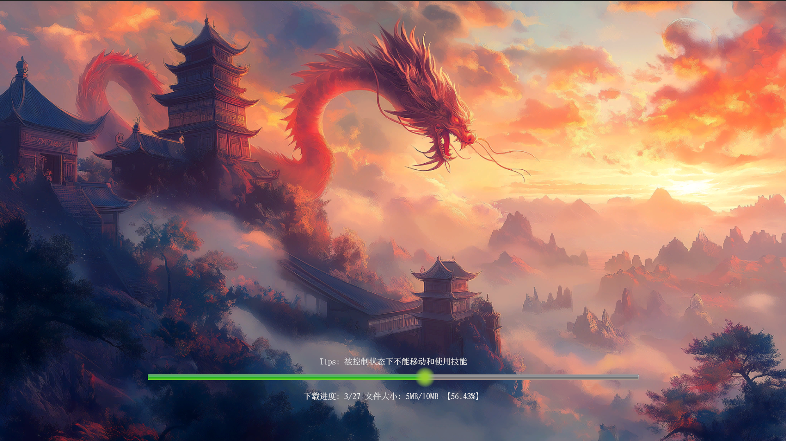
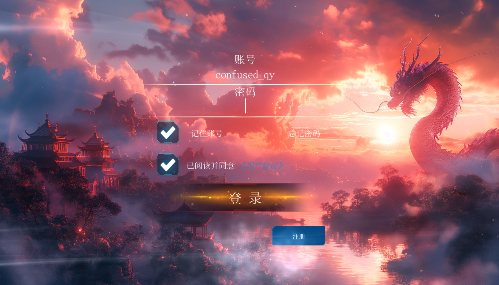

# Lingxu · 灵墟

A solo-developed Unity MMO RPG prototype, progressing from code and asset updates to account login, character creation, and gameplay.

Built with Unity and C#, the project uses HybridCLR and YooAsset for code and asset updates. The client communicates with C# backend services over TCP using Protobuf, while account and character data are stored in MySQL through SqlSugar.

## Part 1: Hot Updates, Accounts & Networking

### Code & Asset Updates

Integrated **HybridCLR + YooAsset** to check resource versions, update manifests, and download required assets. The startup flow then loads supplemental AOT metadata and the gameplay assembly (`Violet_Game.dll`) before entering the login scene. Includes download progress, retries, primary/fallback resource URLs, and Editor tools for compiling and copying DLLs.

```text
Version Check → Manifest Update → Asset Download → AOT Metadata → Assembly Loading → Login Scene
```

<!-- Screenshot 1: The update screen during a download, showing progress and download details.
Save as docs/images/hot-update.png, then move the following line outside this comment:

-->

### Login, Server Selection & Characters

- **Registration & login:** Client input checks, server-side validation, remembered usernames, and consistent error messages.
- **Server selection:** Server names, population indicators, new-server labels, double-click confirmation, and last-used server tracking.
- **Character flow:** Opens character creation or selection based on existing character data, with nickname input and persistent character records.
- **UI separation:** Windows handle input and presentation, Views bind callbacks, and Controllers manage requests, application state, and UI transitions.

<!-- Screenshot 2: The login screen, optionally paired with the registration screen.
Save as docs/images/login-register.png, then move the following line outside this comment:

-->

<!-- Screenshot 3: The server list, showing server status and the current selection.
Save as docs/images/server-list.png, then move the following line outside this comment:

-->

### Networking & Backend

```text
Unity Client ⇄ Login Server ⇄ Center Server ⇄ MySQL
             TCP + Protobuf              SqlSugar
```

The Login Server validates and forwards client requests. The Center Server handles account, server-list, and character operations using SqlSugar for database access. The network layer dispatches messages by protocol command, routes responses by session ID, and supports automatic reconnection.

Registration requests are forwarded only after validation passes, preventing invalid input from reaching account creation. Business error codes are mapped to user-facing messages.

> The verification-code service and the transition from character selection into gameplay are pending. Gameplay documentation will expand as development continues.
